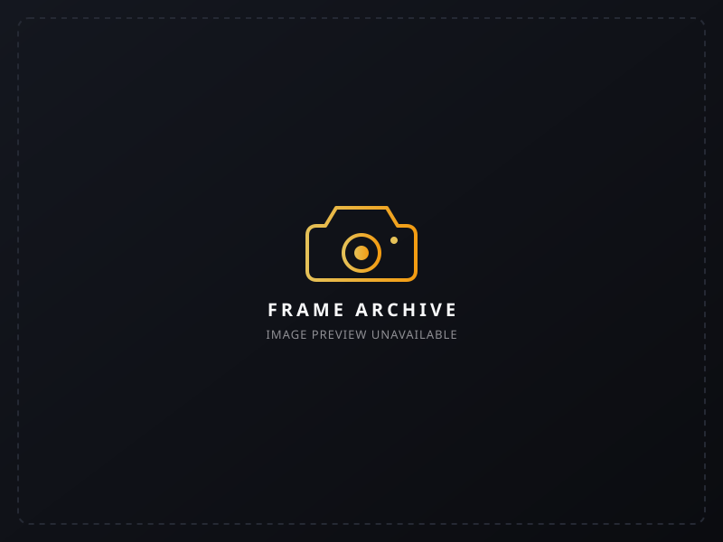

# FRAME. — Modern Responsive Image Gallery

[](https://developer.mozilla.org/en-US/docs/Web/HTML)
[](https://developer.mozilla.org/en-US/docs/Web/CSS)
[](https://developer.mozilla.org/en-US/docs/Web/JavaScript)
[](https://opensource.org/licenses/MIT)

**FRAME.** is a premium photography gallery and editorial portfolio website engineered with clean semantic HTML5, modern CSS3, and Vanilla JavaScript. Built as part of a **Frontend Development Internship**, this project exemplifies modern editorial web design, dark-theme aesthetics, micro-interactions, responsive grid systems, and a fully accessible, keyboard-controllable fullscreen lightbox.

---

## 🌟 Key Features

### 1. Modern Editorial Dark Theme
- **Deep Obsidian Palette**: Refined dark charcoal/black interface (`#0a0b0e`) with warm champagne gold accents (`#e5c158`) and frosted glassmorphism elements.
- **Editorial Typography**: Pairing of **Syne** (geometric luxury editorial display) and **Plus Jakarta Sans** (clean, accessible UI font).
- **Ambient Lighting Effects**: Subtle radial glow gradients and soft drop-shadows that give depth to high-resolution photographs.

### 2. Interactive Category Filtering & Live Search
- **Dynamic Category Filters**: Instant filtering across **All**, **Nature**, **Architecture**, **Portraits**, and **Travel** with dynamic count badges.
- **Real-time Live Search**: Instant multi-field search allowing users to filter images by title, location, camera gear, and story keywords.
- **Smooth State Transitions**: Fluid fade and scale animations when switching categories or modifying search parameters.
- **Empty State Handling**: Graceful fallback UI with a one-click filter reset button when queries return zero results.

### 3. Full-Featured Lightbox Viewer
- **Fullscreen Modal Experience**: Frosted glass backdrop with deep blur (`backdrop-filter: blur(24px)`) and background scroll locking (`overflow: hidden`).
- **Complete Image Metadata**: Displays title, narrative description, location, camera model and lens setup, and capture year.
- **Interactive Controls**:
  - **Previous (←) and Next (→)** buttons with smooth cycling navigation.
  - **Zoom Toggle**: Inspect photography details with interactive magnification.
  - **High-Resolution Download**: Quick link to view or save the original high-resolution photograph.
  - **Click Outside to Close**: Clicking outside the image on the backdrop dismisses the modal.
- **Keyboard Shortcuts**:
  - `Escape`: Close lightbox.
  - `ArrowLeft`: Navigate to previous photograph.
  - `ArrowRight`: Navigate to next photograph.
- **Mobile Touch Gestures**: Native touch swipe detection (swipe left for next, swipe right for previous).

### 4. Interactive Hover & Micro-Animations
- **Gentle Image Zoom**: Smooth scale transition on hover (`transform: scale(1.08)`).
- **Rich Card Overlays**: Gradient bottom overlay revealing photographer notes, camera specs, and an interactive zoom icon badge.
- **Preloading Engine**: Automatic background preloading of adjacent images in the lightbox for instantaneous transitions.

### 5. Fully Responsive & Accessible
- Seamlessly optimized across **Desktop (1440px+)**, **Laptop (1024px)**, **Tablet (768px)**, and **Mobile (375px–425px)**.
- Mobile navigation drawer with animated hamburger toggle.
- Full keyboard focusability (`tabindex`, `:focus-visible` styling).
- Accessible ARIA attributes (`role="dialog"`, `aria-modal="true"`, `aria-live="polite"`, `aria-label`).
- High-res image fallback handling with local SVG placeholders.
- Respects user preference for reduced motion (`prefers-reduced-motion`).

---

## 📸 Screenshots

> *Tip: Place high-resolution screenshots of the desktop view, mobile view, and lightbox in the `assets/images/` directory and update the links below.*

| Desktop Showcase | Fullscreen Lightbox | Mobile View |
| :---: | :---: | :---: |
|  |  |  |

---

## 📁 Project Structure

```text
image-gallery/
│
├── index.html               # Semantic HTML5 layout and accessibility structure
│
├── css/
│   └── style.css            # Custom CSS variables, responsive grid, animations, dark theme
│
├── js/
│   └── script.js            # Modular Vanilla JavaScript, state management, lightbox, filters
│
├── assets/
│   └── images/
│       ├── placeholder.svg  # Elegant offline/fallback SVG vector
│       └── photographer.svg # Photographer profile illustration & badge
│
└── README.md                # Comprehensive project documentation
```

---

## 🛠️ Technologies Used

- **HTML5**: Semantic elements (`<header>`, `<nav>`, `<main>`, `<section>`, `<article>`, `<footer>`).
- **CSS3**:
  - Modern CSS Grid & Flexbox layouts.
  - CSS Custom Properties (Variables) for theming.
  - Glassmorphism via `backdrop-filter`.
  - Keyframe animations & smooth cubic-bezier transitions.
  - Fluid typography via CSS `clamp()`.
- **Vanilla JavaScript (ES6+)**:
  - Module pattern with self-invoking function (`IIFE`).
  - Declarative dataset array of 20 photography objects.
  - Debounced input filtering and DOM rendering.
  - Lightbox controller with keyboard listeners and touch swipe logic.
  - Image preloading cache.
  - Scroll spy and dynamic copyright year.
- **Unsplash CDN**: High-definition curated photography.

---

## 🚀 How to Run Locally

### Option 1: VS Code Live Server (Recommended)
1. Open Visual Studio Code.
2. Open this project directory (`File > Open Folder... > image-gallery`).
3. Install the **Live Server** extension by *Ritwick Dey* if not already installed.
4. Right-click `index.html` in the sidebar and choose **"Open with Live Server"**.
5. Your browser will open the website at `http://127.0.0.1:5500/index.html`.

### Option 2: Python Local Server
If Python is installed on your system, run:
```bash
# Python 3
python -m http.server 8000
```
Then visit `http://localhost:8000` in any web browser.

### Option 3: Node.js (npx serve)
```bash
npx serve .
```

### Option 4: Direct Browser Opening
Simply double-click `index.html` or drag and drop it into Google Chrome, Microsoft Edge, Mozilla Firefox, or Safari.

---

## ⌨️ Accessibility & Controls

| Key / Gesture | Action |
| :--- | :--- |
| **Click Card** / <kbd>Enter</kbd> / <kbd>Space</kbd> | Opens photograph in Lightbox |
| <kbd>Esc</kbd> | Closes Lightbox modal or mobile menu |
| <kbd>→</kbd> (Arrow Right) | Next photograph |
| <kbd>←</kbd> (Arrow Left) | Previous photograph |
| **Touch Swipe Left** | Next photograph (Mobile) |
| **Touch Swipe Right** | Previous photograph (Mobile) |
| **Touch Swipe Down** | Closes Lightbox modal (Mobile gesture) |
| **Double Tap Image** | Toggles Zoom In/Out (Mobile gesture) |
| **Click Backdrop** | Closes Lightbox modal |

---

## 🔮 Future Enhancements

- [ ] **Favorites / Bookmarking**: LocalStorage-backed bookmarking of favourite photographs.
- [ ] **EXIF Data Inspector**: Expandable technical drawer showing ISO, shutter speed, and aperture curves.
- [ ] **Fullscreen Presentation Mode**: Automated slideshow playback with configurable timer.
- [ ] **Photo Sharing**: Web Share API integration for one-tap social sharing.

---

## 📄 License

This project is open-source under the [MIT License](LICENSE). Built for educational and portfolio demonstration purposes.
